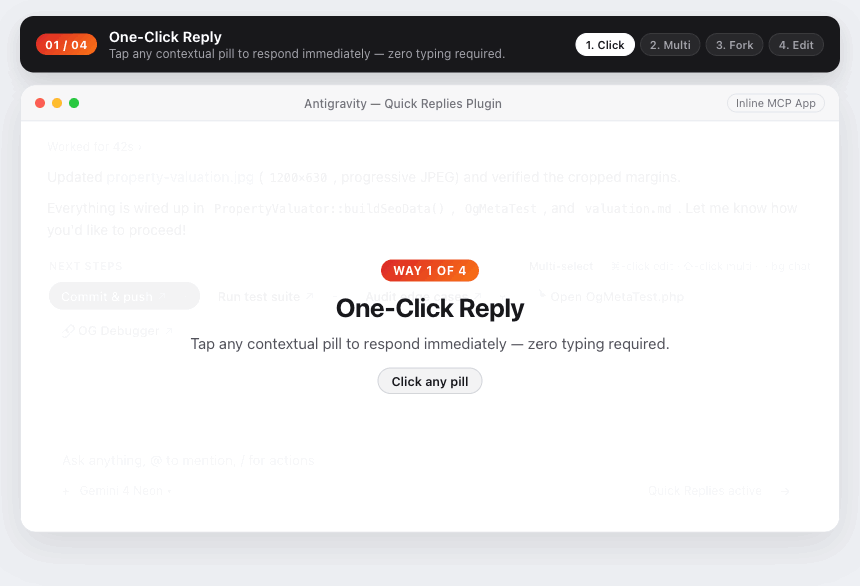
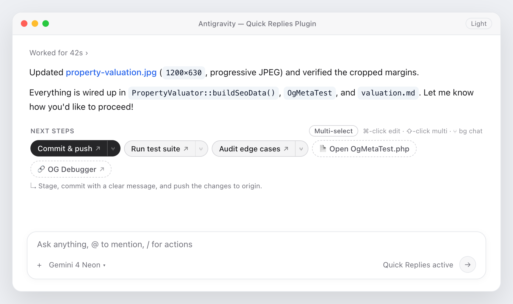
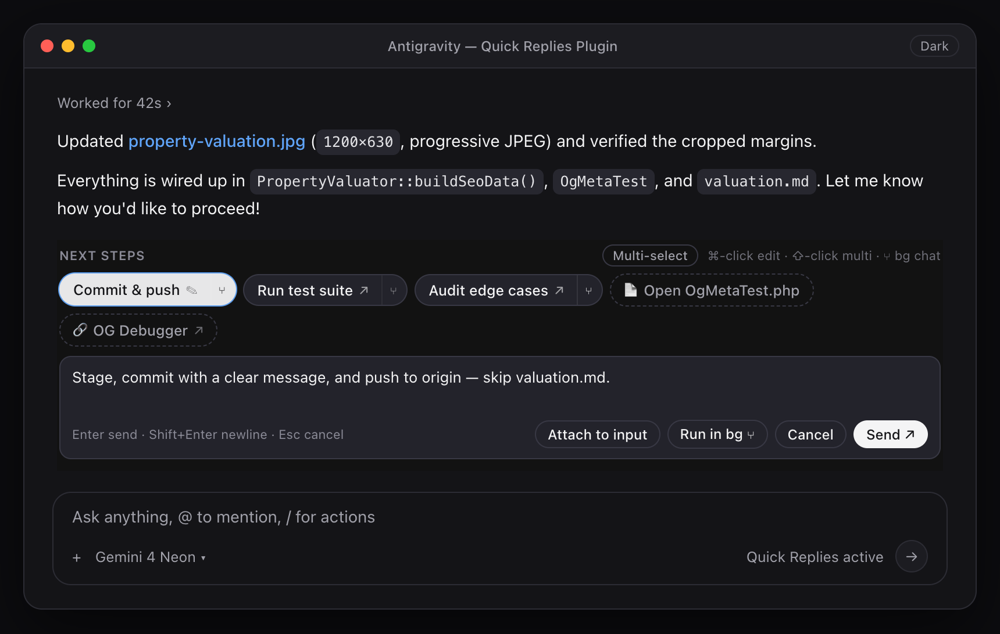
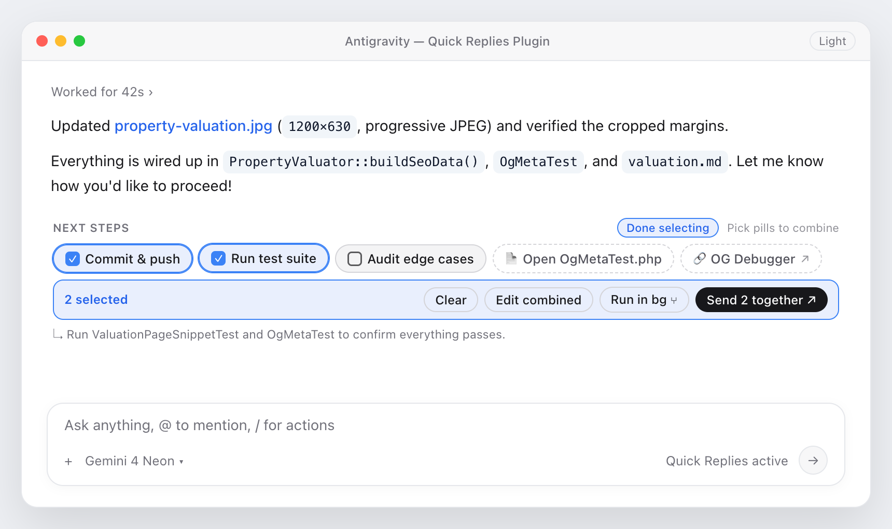

<p align="center">
  
</p>

<h1 align="center">Quick Replies for Antigravity</h1>

<p align="center">
  Contextual one-tap reply and action pills rendered inline right above your chat input box in Google Antigravity.
</p>

<p align="center">
  
</p>

Built as an **Antigravity Plugin** combining an **MCP App** (`@modelcontextprotocol/ext-apps`), an always-on agent rule (`rules/AGENTS.md`), and a **`Stop` lifecycle hook guard** (`hooks.json`). Both the MCP server (`dist/server.mjs`) and the UI (`dist/inline.html`) are pre-bundled into self-contained files—**no `npm install` required** to use.

---

## Screenshots

### Contextual Inline Pills & Zero-Wait Actions (Light Mode)
Hover any pill to preview the full prompt before sending. Dashed pills open workspace files directly in the side pane (`📄`) or open external URLs (`🔗`) with zero LLM round-trip.

<p align="center">
  
</p>

### Inline Editing on `⌘+Click` (Dark Mode)
Hold **`⌘+Click`** (or `Ctrl+Click` / `Option+Click`) on any pill to tweak the prompt before sending, attach it to the composer context (`Attach to input`), or launch it in a background chat (`Run in bg ⑂`).

<p align="center">
  
</p>

### Multi-Select Batching (`Shift+Click`)
Hold **`Shift+Click`** (or toggle **Multi-select**) to pick multiple pills and combine them into a single prompt—then tap **Send N together ↗**, **Edit combined**, or **Run in bg ⑂**.

<p align="center">
  
</p>

---

## Features

- **One-tap contextual replies**: Automatically suggests 2–6 tailored follow-up pills at the end of turns with next steps, plan approvals, or choices.
- **Edit before sending (`⌘+Click` / `Ctrl+Click` / `Option+Click`)**: Opens an auto-focused inline edit box pre-filled with the pill's full prompt (`Enter` to send, `Shift+Enter` for newline, `Esc` to cancel, or **Attach to input** via `updateModelContext`).
- **Multi-select batching (`Shift+Click` or Multi-select toggle)**: Combine multiple pills into a single prompt and send them together in one turn, edit the combined draft, or run the batch in a background chat.
- **Background-chat forking (`⑂`)**: Spin off any secondary suggestion into a new background conversation in the same project (`target: "new"`) without derailing your active thread.
- **Zero-wait File & URL action pills**:
  - `kind: "file"` opens a referenced workspace file directly in the side pane (`com.google.antigravity/toggle-aux-pane`).
  - `kind: "url"` opens a cited `http://` or `https://` link externally (`app.openLink()`).
- **Reliable `Stop` hook guard**: A lightweight lifecycle hook (`hooks.json` → `hooks/stop-check.mjs`) inspects the current turn's transcript on normal turn completion and nudges the agent once if `suggest_replies` was skipped on a substantive reply (e.g. pure-text brainstorming turns). Automatically skips subagents, `ask_question` turns, bare one-line answers, errors/cancellations, and background waits, and guards on `continuationActive` so it never loops.

## Requirements

- **Node.js 20+** (only `node` is needed at runtime; dependencies are pre-bundled in `dist/`).

## Installation

### Via Antigravity CLI (`agy`)

```bash
agy plugin install https://github.com/cheryeong/antigravity-quick-replies
```

### Manual Local Install

Clone or copy this directory into your global Antigravity plugins folder:

```bash
git clone https://github.com/cheryeong/antigravity-quick-replies ~/.gemini/config/plugins/quick-replies
```

Antigravity discovers it automatically—no restart required. When prompted on the first pill bar, select **Always allow** for `suggest_replies` so future pills appear automatically.

## Keyboard & Mouse Shortcuts

| Action | Shortcut |
| :--- | :--- |
| Send reply immediately | **Click** pill |
| Edit prompt before sending | **`⌘+Click`** *(or `Ctrl+Click` / `Option+Click`)* |
| Select multiple pills to batch | **`Shift+Click`** *(or click **Multi-select**)* |
| Fork into background conversation | Click **`⑂`** on the pill |
| Open file / external URL (zero LLM wait) | **Click** dashed file/link pill |

## Development

To modify the TypeScript UI (`src/inline.ts`) or MCP server (`src/server.mjs`) and rebuild the pre-bundled `dist/` artifacts:

```bash
npm install
npm run build
```

Then validate the plugin bundle:

```bash
agy plugin validate --strict .
```

## Plugin Structure

```text
quick-replies/
├── plugin.json          # Plugin manifest
├── mcp_config.json      # Local stdio MCP server config
├── hooks.json           # Stop lifecycle hook config
├── hooks/
│   ├── stop-check.sh    # Portable launcher for stop-check.mjs
│   └── stop-check.mjs   # Guards against skipped suggest_replies calls
├── assets/logo.png      # 256×256 transparent plugin icon
├── docs/                # README screenshots & animated demo GIF
├── bin/run-server.sh    # Portable launcher for dist/server.mjs
├── dist/
│   ├── inline.html      # Self-contained MCP App HTML bundle
│   └── server.mjs       # Self-contained Node ESM MCP server bundle
├── rules/AGENTS.md      # Always-on rule instructing when/how to emit pills
├── src/                 # Source files (server.mjs, inline.ts)
└── scripts/build.mjs    # esbuild bundler for both UI and server
```

## License

MIT — see [LICENSE](./LICENSE).
